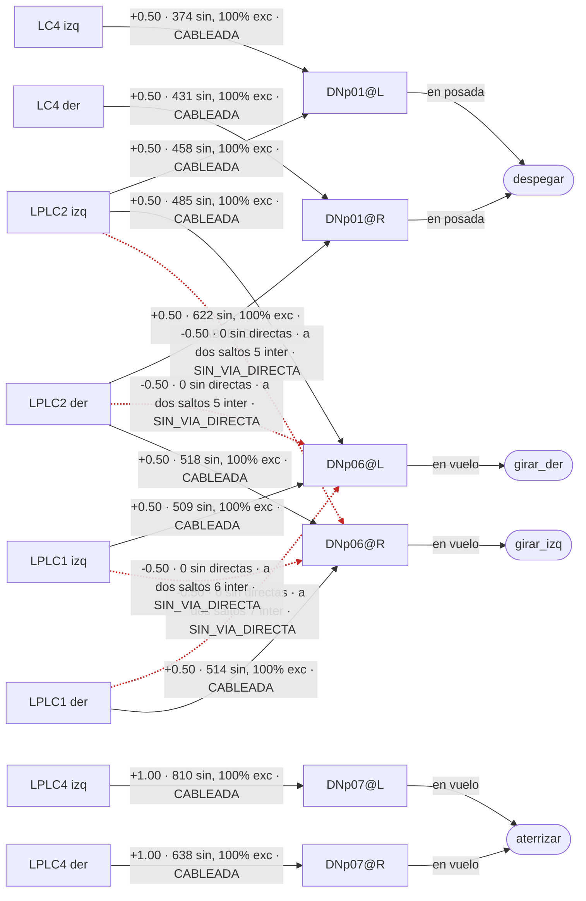

# Grafo de escape (Topo v0.1)

Generado por tools/topo/topo_grafo.py desde el programa, sin tocarlo a mano. Flecha punteada y roja: el programa hace esa cuenta pero la mosca no tiene sinapsis directas ahi.

| flecha | signo en el programa | sinapsis directas | neuronas | excitatoria | veredicto | a dos saltos: intermediarias, sinapsis, inhibitoria |
|---|---|---|---|---|---|---|
| LC4@L a DNp01@L | +0.50 | 374 | 54 | 100 % | CABLEADA | 30, 744, 58 % |
| LPLC2@L a DNp01@L | +0.50 | 458 | 94 | 100 % | CABLEADA | 55, 1352, 42 % |
| LC4@R a DNp01@R | +0.50 | 431 | 50 | 100 % | CABLEADA | 39, 1087, 64 % |
| LPLC2@R a DNp01@R | +0.50 | 622 | 95 | 100 % | CABLEADA | 67, 1680, 32 % |
| LPLC4@L a DNp07@L | +1.00 | 810 | 49 | 100 % | CABLEADA | 43, 1544, 39 % |
| LPLC4@R a DNp07@R | +1.00 | 638 | 43 | 100 % | CABLEADA | 41, 1278, 44 % |
| LPLC1@L a DNp06@L | +0.50 | 509 | 65 | 100 % | CABLEADA | 39, 1242, 22 % |
| LPLC2@L a DNp06@L | +0.50 | 485 | 103 | 100 % | CABLEADA | 59, 2286, 37 % |
| LPLC1@R a DNp06@L | -0.50 | 0 | 0 |  | SIN_VIA_DIRECTA | 7, 291, 5 % |
| LPLC2@R a DNp06@L | -0.50 | 0 | 0 |  | SIN_VIA_DIRECTA | 5, 284, 0 % |
| LPLC1@R a DNp06@R | +0.50 | 514 | 71 | 100 % | CABLEADA | 51, 1641, 29 % |
| LPLC2@R a DNp06@R | +0.50 | 518 | 97 | 100 % | CABLEADA | 62, 2892, 36 % |
| LPLC1@L a DNp06@R | -0.50 | 0 | 0 |  | SIN_VIA_DIRECTA | 6, 333, 2 % |
| LPLC2@L a DNp06@R | -0.50 | 0 | 0 |  | SIN_VIA_DIRECTA | 5, 325, 0 % |

| tipo (los dos lados) | descendente (las dos) | sinapsis | neuronas |
|---|---|---|---|
| LC4 | DNp01 | 805 | 104 |
| LPLC1 | DNp06 | 1023 | 136 |
| LPLC2 | DNp01 | 1080 | 189 |
| LPLC2 | DNp06 | 1003 | 200 |
| LPLC4 | DNp07 | 1448 | 92 |
